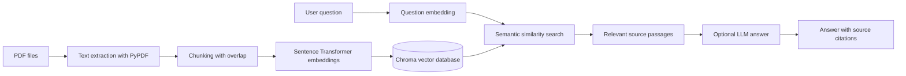

# DocBrain AI

> A document-understanding and semantic-search application that lets users ask natural-language questions about PDF files and receive answers grounded in retrieved source passages.

DocBrain AI is a Retrieval-Augmented Generation (RAG) project built for exploring one or more PDF documents through a simple Streamlit interface. It extracts PDF text, breaks it into meaningful passages, converts those passages into vector embeddings, and finds the most relevant evidence for each question. An optional LLM then produces a concise answer using only that retrieved evidence.

## Why DocBrain AI?

Long PDFs are difficult to search with ordinary keyword matching. Exact words may be missing even when a document contains the same idea in different language. DocBrain AI uses semantic search, which compares the meaning of a question with the meaning of document passages.

For example, a user can ask *“What are the main limitations of the proposed system?”* even when the PDF uses phrases such as *constraints*, *challenges*, or *future work* rather than the word *limitations*.

## Features

- Upload and index multiple text-based PDF documents.
- Extract text page by page with filename and page-number metadata.
- Split text into overlapping passages to preserve local context.
- Create local sentence embeddings with `all-MiniLM-L6-v2`.
- Store document passages and embeddings in a persistent Chroma vector database.
- Retrieve passages with cosine-similarity semantic search.
- Search all indexed documents or limit a question to selected PDFs.
- Adjust the number of retrieved passages and minimum similarity threshold.
- Display every source passage used, including its filename, page number, and match score.
- Generate optional LLM answers grounded only in retrieved passages.
- Support OpenAI-compatible providers such as OpenRouter through environment variables.
- Remove a single indexed PDF or clear the full local index from the interface.
- Continue working in retrieval-only mode when no LLM API key is configured.

## How it works



### RAG workflow

1. **Ingestion:** The user uploads one or more PDFs.
2. **Text extraction:** PyPDF reads selectable text from every page.
3. **Chunking:** Each page is divided into overlapping word-based passages.
4. **Embedding:** A Sentence Transformers model converts passages into vectors that represent meaning.
5. **Storage:** Chroma persists the vectors, original passage text, filename, and page number locally.
6. **Retrieval:** The user’s question is embedded and compared with stored vectors using cosine similarity.
7. **Generation:** When an LLM provider is configured, the application sends only the question and top retrieved passages to the model, instructing it to answer from that evidence and cite sources.
8. **Verification:** The user can expand **Sources used** to inspect the passages and page numbers behind the answer.

## Tech stack

| Area | Tools used |
| --- | --- |
| User interface | Streamlit |
| Programming language | Python |
| PDF processing | PyPDF |
| Embeddings | Sentence Transformers (`all-MiniLM-L6-v2`) |
| Vector database | ChromaDB |
| LLM integration | OpenAI Python SDK with OpenAI-compatible endpoints |
| Environment configuration | python-dotenv |

## Project structure

```text
DocBrain-AI/
├── app.py                 # Streamlit interface, chat flow, and optional LLM generation
├── docbrain.py            # PDF extraction, chunking, embedding, storage, and search
├── requirements.txt       # Python dependencies
├── .env.example           # Safe configuration template without real secrets
├── .gitignore             # Excludes secrets, local databases, and virtual environments
└── data/chroma/           # Created at runtime; local vector database, excluded from Git
```

## Installation and local setup

### Requirements

- Python 3.11 or 3.12 is recommended.
- Internet access is needed the first time dependencies and the embedding model are downloaded.

### Windows

```powershell
py -3.12 -m venv .venv
.\.venv\Scripts\python.exe -m pip install --upgrade pip
.\.venv\Scripts\python.exe -m pip install -r requirements.txt
Copy-Item .env.example .env
.\.venv\Scripts\python.exe -m streamlit run app.py
```

Open the local URL shown by Streamlit, usually `http://localhost:8501`.

### macOS and Linux

```bash
python3.12 -m venv .venv
.venv/bin/python -m pip install --upgrade pip
.venv/bin/python -m pip install -r requirements.txt
cp .env.example .env
.venv/bin/python -m streamlit run app.py
```

## Optional LLM configuration

DocBrain AI performs semantic retrieval without an API key. Add an API key only when you want a model to combine the retrieved passages into a natural-language answer.

Create a `.env` file from `.env.example` and add your provider settings. For OpenRouter free models:

```text
OPENAI_API_KEY=your_openrouter_api_key
OPENAI_BASE_URL=https://openrouter.ai/api/v1
OPENAI_MODEL=openrouter/free
```

The `.env` file must remain private. It is already excluded by `.gitignore` and must never be committed to GitHub.

## Usage

1. Start the app with `streamlit run app.py`.
2. Upload one or more text-based PDFs in the sidebar.
3. Select **Index selected PDFs**.
4. Ask a question in the **Ask your documents** tab.
5. Optionally filter the search to particular PDFs or change retrieval settings.
6. Read the answer and open **Sources used** to verify the evidence.
7. Use **Manage documents** to remove individual PDFs or clear the local index.

## Privacy and security

- PDF text and embeddings are saved locally in `data/chroma/`.
- The app does not upload the original PDF itself to an LLM provider.
- If an LLM is enabled, the current user question and the retrieved text passages are sent to the configured provider to generate an answer.
- API keys are read from `.env`; they are not hard-coded in the source code.
- The local vector database, virtual environment, and `.env` are excluded from version control.

## Limitations

- Scanned PDFs require OCR before they can be indexed because they do not contain selectable text.
- Semantic retrieval quality depends on the quality and structure of the source document.
- LLM answers should always be verified against the displayed source passages.
- This is a local learning prototype and is not designed for sensitive production documents without additional access control and security measures.

## Future improvements

- OCR support for scanned documents.
- Support for DOCX, TXT, and CSV files.
- Hybrid keyword and semantic retrieval.
- Reranking of retrieved passages.
- Conversation memory scoped to each document collection.
- User authentication and separate document libraries.
- Docker deployment and cloud-hosted vector storage.
- Evaluation metrics for retrieval relevance and grounded-answer quality.

## Resume description

**DocBrain AI | Document Understanding & Semantic Search System**

- Built a PDF intelligence application that extracts, chunks, embeds, and persistently indexes document content for semantic retrieval.
- Designed a Retrieval-Augmented Generation pipeline that retrieves relevant passages from a Chroma vector database and produces source-grounded answers through an OpenAI-compatible LLM provider.
- Developed an interactive Streamlit interface for multi-PDF upload, natural-language querying, document management, retrieval filtering, and page-level source verification.

**Tech:** Python, Streamlit, RAG, Sentence Transformers, ChromaDB, Vector Embeddings, PyPDF, OpenAI-compatible APIs

## License

This project is provided for learning and portfolio purposes.
